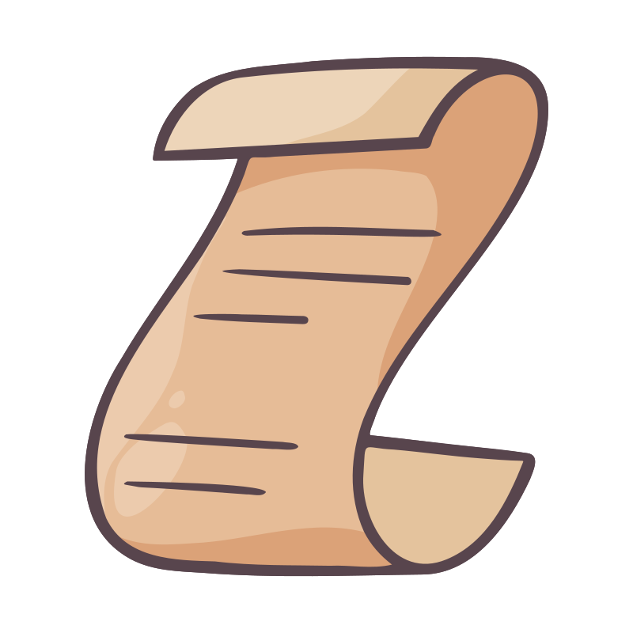
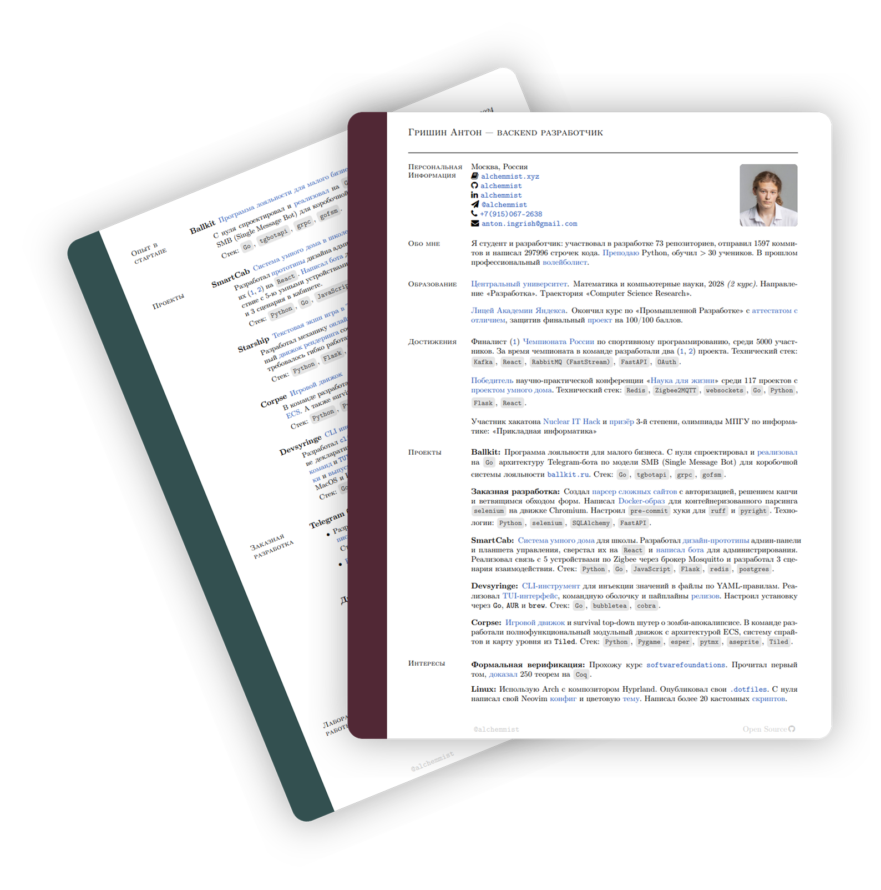

<h2> Resume (CV)</h2>

[](https://github.com/alchemmist/CV)
 


[](https://github.com/alchemmist/CV/actions/workflows/build.yaml)

This is my Curriculum Vita (CV) as a software engineer. I have two versions of CV ([english](/pdf/english.pdf) and [russian](/pdf/russian.pdf)) already rednered in [`pdf`](/pdf) directory. This repo have MIT license, so you can use it as a template for your CV or or whatever you want.

The [`resume.cls`](tex/resume.cls) class defines the layout. Resume content lives
in `tex/*.tex`; formatting and photo placement belong to the class.

### Start your own resume

Edit `example.tex` in the repository root and run `make example`. The result is
`pdf/example.pdf`. The example needs no personal assets and works without a
photo or footer. To keep several resumes, copy it to `tex/my-resume.tex`;
`make build` builds every resume in `tex/`.

Keep personal data in one preamble block:

```tex
\documentclass[margin,line]{resume}
\resumesetup{
  language=english,
  name={Your Name},
  title={HR Partner},
  location={City, Country},
  contacts={
    \contact[\faEnvelope]{you@example.com}{mailto:you@example.com}
    \contact{Portfolio}{https://example.com}
  },
  footer-left={},
  footer-right={}
}
\begin{document}
\begin{resume}
  \section{\mysidestyle Experience}
  Your experience.
\end{resume}
\end{document}
```

`language` accepts `english` or `russian` and sets the default contact heading.
Set `contact-title` after `language` to override it, or use `{}` to hide it.
Name, title, location, contacts, photo and footers are optional. A contact has
an optional icon, a display label, and a URL; an empty URL produces plain text,
and an empty label omits the contact. Put braces around values containing commas.
`\resumecontacts{...}` replaces the contact list. Shared personal data for the
included resumes lives in `tex/anton-profile.sty`, outside the reusable class.

Set `photo={../images/avatar.png}` in `\resumesetup` or declare
`\photo{../images/avatar.png}`. The default width is 25.5 mm, preserving aspect
ratio. `\photo[35mm]{...}` changes the width; `\photo{}` removes the photo.
The right upper corner aligns with the right text margin and top of the contact
block. Automatic profiles reserve enough height for the photo, even with a short
contact list. Paths are relative to `tex/`; PDF, PNG and JPEG are supported.

The lower-level `\resumeheading{...}` and `contactinfo` environment remain
available for custom headers. Do not combine a manual heading/contact block
with the corresponding automatic profile fields.

### Accent, density and photo presets

Add these keys to `\resumesetup`:

```tex
\resumesetup{
  accent=forest,
  density=normal,
  photo={../images/avatar.png},
  photo-size=standard
}
```

| Key | Values | Default |
| --- | --- | --- |
| `accent` | `navy`, `forest`, `plum`, `charcoal`, `red` | `navy` |
| `accent-html` | Six hex digits, for example `6C1A36` | Not set |
| `density` | `compact`, `normal`, `spacious` | `normal` |
| `photo-size` | `none`, `small` (20 mm), `standard` (25.5 mm) | `standard` |
| `photo-width` | Positive LaTeX length, for example `30mm` | 25.5 mm |

Density adjusts paragraph, section and list spacing together, keeping font sizes
and page geometry unchanged. `normal` preserves the original layout. Accent
changes the sidebar; links keep their familiar readable blue. The last color
setting wins. Set `photo-width` after `photo-size` for a custom width.
`photo-size=none` hides the photo without discarding its path.

### Long content and page breaks

Long names and professional titles wrap within the header width. Contacts wrap
when their label does not fit; photo width reserves a separate contact column
with a 5 mm gap. A photo that leaves less than 30 mm for contacts produces an
explicit error. A photo declared with the `photo` key also works without contacts;
an entirely empty contact list leaves no heading or blank block.

Section headings reserve room for the first lines of their content. Use
`resumeentry` to keep a role heading with the start of its description while
allowing a long description to continue on another page:

```tex
\section{\mysidestyle Experience}
\begin{resumeentry}{HR Partner}{Example Company}{2023--2026}
  Developed an onboarding program.
  \begin{itemize}
    \item Coordinated interviews and manager training.
  \end{itemize}
\end{resumeentry}
```

The three arguments are role, organization and period; organization and period
can be empty. Use `\url{https://example.com/long-path}` for a displayed URL in
body text, so it can wrap. A `\href{...}{label}` uses ordinary text line breaks
for its label. Arbitrary unbreakable boxes such as `\mbox` and `\inlinecode`
remain unbreakable; shorten or split their content if needed.

The build stops at LaTeX errors and missing hyphenation patterns. To diagnose
text extending beyond the right margin in a particular result, run:

```sh
make check-pdf PDF=pdf/my-resume.pdf
```

This check requires PyMuPDF and reports the page, offending text, and overflow
in PDF points. It does not replace visual review of the PDF.

### Yandex internship resume

[Short Russian resume focused on my Yandex internship](pdf/short-yandex.pdf) · [LaTeX source](tex/short-yandex.tex). Uses the short resume layout with a `#fc3e1c` accent stripe.

### Custom contact icons

Use `\resumeicon{../images/blog-logo.pdf}` for an image icon aligned with the
text. An optional height, for example `\resumeicon[1.2em]{logo.png}`, controls
its size. The class contains no personal logo or links.

### Sidebar logos

Declare a comma-separated list of image paths in the preamble, after
`\documentclass`, to stack logos in the colored sidebar:

```tex
\sidebarlogos{../images/yandex-mark.pdf, ../images/another-logo.png}
```

The first logo sits at the bottom; subsequent logos stack upward with a 3 mm
gap. Logos are centered within the visible stripe, start 6 mm above the page
edge, and fit within the stripe (2 mm horizontal padding) and a 14 mm height
while preserving their aspect ratios. The stack repeats on every page.
Omit the command or use `\sidebarlogos{}` for no logos; calling it again replaces
the list. Paths are relative to the LaTeX build directory (`tex/` here).
PDF, PNG, and JPEG work with the existing pdfLaTeX build.

The class adds no borders, shadows, backgrounds, or cropping. Decoration and
transparent padding already present in an image remain part of that image.
Use an asset with a transparent background for a bare logo. The included
`yandex-mark.pdf` contains only the white mark from the
[Wikimedia Yandex icon](https://commons.wikimedia.org/wiki/File:Yandex_icon.svg),
without its circular background; its vector source is `images/yandex-mark.svg`.

### Building

Build every `tex/*.tex` file into `pdf/` with:

```sh
make build
```

On macOS, install [TinyTeX](https://yihui.org/tinytex/) or MacTeX and make sure
`pdflatex` and `latexmk` are on `PATH`. For a minimal TinyTeX installation, add
the packages used by this template:

```sh
tlmgr install latexmk babel-english babel-russian hyphen-russian cyrillic lh cm-super fontawesome \
  tcolorbox listings tikzfill textpos enumitem wrapfig fancyhdr eso-pic grfext needspace xurl
```

A user-local TinyTeX installation can live in `~/Library/TinyTeX`, with command
symlinks in `~/.local/bin`. The build runs natively on macOS; Docker is not
required. `babel-russian` and `hyphen-russian` are separate packages: the latter
provides Russian hyphenation patterns. `make build` fails if LaTeX reports
missing patterns.

### Layout checks

`make test` requires `latexmk`, the LaTeX packages used by `make build`, and
PyMuPDF (`python3 -m pip install pymupdf`). It compiles fixtures with portrait
and landscape images, different sizes and page geometry, replaced and omitted
photos, and a second page. It checks alignment, aspect ratios and unchanged
text positions. Profile tests also cover both languages, optional fields,
colors, density, long headings and URLs, photo clearance and page boundaries.
Set `CV_TEST_ARTIFACTS=/absolute/path` when running `make test` to retain profile
fixture PDFs for visual review. It also checks the right text margin in `pdf/short-yandex.pdf`;
run `make build` first to check the current sources.

To compare all resumes against PDFs built before a layout change, keep a copy
of that `pdf/` directory, run `make build`, then run:

```sh
make test BASELINE=/absolute/path/to/baseline-pdf
```

The baseline and current PDFs must be built with the same TeX distribution and
fonts. The comparison checks text coordinates, page breaks, and rendered pixels
at 144 dpi outside the old and new photo rectangles. Raster comparison allows
a difference of at most 2/255 per color channel for renderer rounding; text
positions are checked separately.

### Questions | Contribute

If you have questions about this repo or you want to contribute, [text me](https://t.me/alchemmist)!

### Demo



### License

Licensed under of The [MIT](./LICENSE) License.

### Thanks for review

- Anatoly Zinoviev
- Alexander Shakhov
- Natalia Kuznetsova
- Mikhail Doshevsky
- Yegor Bugayenko
- Nikita Sobolev
- Maxim Smirnov
- Grigory Petrov
- Pavel Sokolov
- Mikhail Flenov
- Julia Lukyanova
- Ruslan Masgutov
- Alexey Goloburdin
- Mark Melixetyan
- Kristina Lozbina
- Ksenia Vdovkina

If you find your name here and you **don't want** for put your name here, text me on email: [`anton.ingrish@gmail.com`](mailto:anton.ingrish@gmail.com). If you belive I make a typo in your name, sorry for that and report it in issue.
